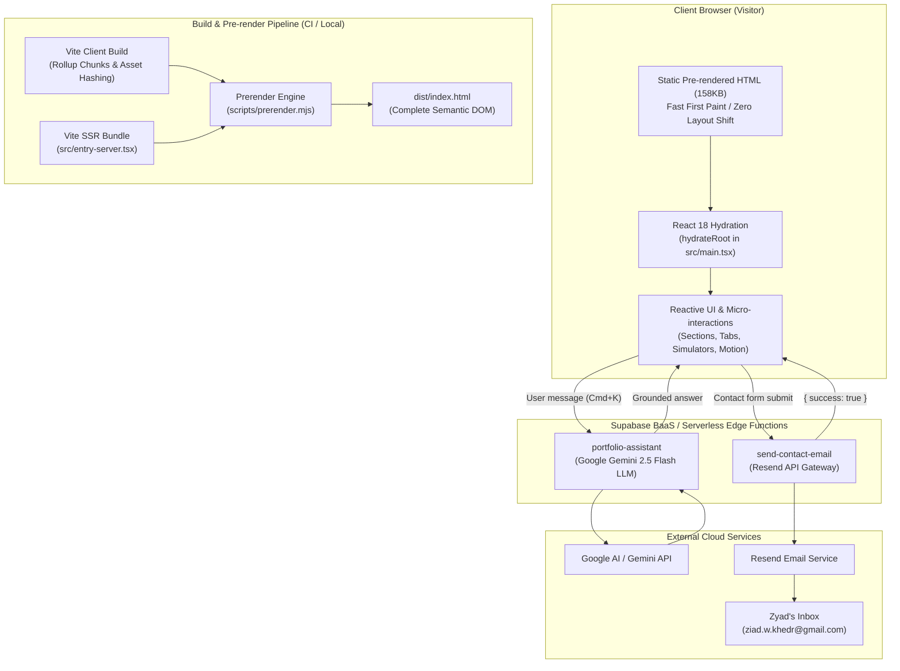

# System Architecture & Technical Design

**Portfolio Owner:** Zyad Wael — Mobile Software Engineer & Data Science Student  
**Repository:** [https://github.com/ZyadWKhedr/zyadwael-portfolio-flutter](https://github.com/ZyadWKhedr/zyadwael-portfolio-flutter)  
**Live Site:** [https://zyadwkhedr.github.io/zyadwael-portfolio-flutter/](https://zyadwkhedr.github.io/zyadwael-portfolio-flutter/)

---

## 1. Architectural Overview

The portfolio is architected as an **Editorial Engineering Showcase** optimized for high-performance delivery over static hosting (GitHub Pages). It combines modern reactive UI capabilities (React 18, Tailwind CSS, Framer Motion) with compile-time static site pre-rendering (SSR) and edge-computed serverless integrations (Supabase Edge Functions).

### High-Level Architectural Diagram



---

## 2. Key Architectural Decisions (ADRs)

### ADR-1: Static HTML Pre-rendering (Hydration-Ready SSR)
- **Problem**: Client-rendered SPAs on GitHub Pages typically display an empty `<div id="root"></div>` during initial load, resulting in poor First Contentful Paint (FCP), layout shifts, and weak SEO indexing for search engine crawlers that do not execute heavy JavaScript.
- **Solution**: We created a dual-pass build in `package.json`:
  1. `vite build` produces the client distribution.
  2. `vite build --ssr src/entry-server.tsx --outDir dist/ssr` bundles the component tree for Node.js.
  3. `scripts/prerender.mjs` executes `entry-server.js` using `renderToString(<Index />)` and injects **158,300+ characters of semantic HTML** directly into `dist/index.html`.
- **Outcome**: Visitors receive a complete, human-readable editorial document in the very first TCP packet. `main.tsx` detects existing DOM children via `container.hasChildNodes()` and seamlessly calls `hydrateRoot` rather than wiping and re-rendering the DOM.

### ADR-2: Base Path Awareness for GitHub Pages
- **Problem**: Deploying to GitHub Pages at `https://zyadwkhedr.github.io/zyadwael-portfolio-flutter/` means the root directory is not `/` but `/zyadwael-portfolio-flutter/`. Absolute URLs (e.g. `/favicon.ico` or `/assets/...`) cause HTTP 404 errors on GitHub Pages.
- **Solution**:
  - `vite.config.ts` sets `base: mode === 'production' ? '/zyadwael-portfolio-flutter/' : '/'`.
  - In `index.html`, all static assets use `%BASE_URL%assets/...` which Vite automatically transforms into `/zyadwael-portfolio-flutter/assets/...` during production builds.
  - In `src/App.tsx`, `BrowserRouter` is configured with `basename="/zyadwael-portfolio-flutter"`.
  - Vite-bundled assets use `import icon from '@/assets/...'`, enabling Rollup to compute fingerprinted, base-aware URLs.

### ADR-3: Dynamic Import Splitting for Heavy Integrations
- **Problem**: The Supabase JavaScript client (`@supabase/supabase-js`) is approximately 170kB. Importing it at the top of the bundle increases initial bundle weight and parse/compile time on the main thread, lowering mobile Lighthouse performance.
- **Solution**: Both `src/services/contactService.ts` and `src/services/assistantService.ts` use dynamic ES module imports:
  ```ts
  const { supabase } = await import('@/integrations/supabase/client');
  ```
- **Outcome**: `@supabase/supabase-js` is deferred into its own chunk (`dist/assets/client-[hash].js`) and only loaded over the network when the visitor opens the AI assistant or submits a contact message.

### ADR-4: Zero-Dependency Interactive In-Browser Mobile Simulators
- **Problem**: Proving mobile engineering capabilities through static text is unconvincing to technical recruiters, while embedding heavy Flutter web wasm builds or WebGL scenes causes 15MB+ downloads and thermal throttling on mobile devices.
- **Solution**: We implemented lightweight, zero-dependency interactive micro-simulators inside [src/components/projects/ProjectInteractiveDemo.tsx](file:///d:/Web/zyadwael-portfolio-flutter/src/components/projects/ProjectInteractiveDemo.tsx).
  - Simulates the core interaction model for Amoomy (carrier bidding), Wofoodi (station radar), Raval (reactive cart), Payss (QR scanner), and Liquid Navbar (fluid canvas).
  - Built with pure CSS transitions and React state hooks; zero external physics or 3D engine overhead.

---

## 3. Directory Layout & Module Responsibilities

```
src/
├── components/
│   ├── layout/          # Global layout wrappers (Navigation, Footer)
│   ├── sections/        # High-level page sections (Hero, SelectedWork, Skills, Writing, Testimonials, About, Contact)
│   ├── projects/        # Project demonstration simulators (ProjectInteractiveDemo)
│   ├── chatbot/         # AI concierge drawer and trigger (AiAssistant)
│   ├── legacy/          # Preserved historical components (archived, non-polluting)
│   └── ui/              # Headless Radix & shadcn/ui components (dialog, tabs, badge, button)
├── data/                # Strongly-typed data records (projects.ts, testimonials.ts, skills.ts, articles.ts)
├── hooks/               # Reusable React hooks (use-mobile.tsx, use-toast.ts)
├── integrations/        # BaaS client singletons (supabase/client.ts, supabase/types.ts)
├── lib/                 # Core utilities (utils.ts cn helper, analytics.ts)
├── pages/               # Route components (Index.tsx, NotFound.tsx)
├── services/            # Decoupled backend integrations (contactService.ts, assistantService.ts)
├── types/               # Formal TypeScript interfaces (project.ts, testimonial.ts, article.ts, skill.ts)
├── App.tsx              # Application shell with React Router & React Query
├── entry-server.tsx     # SSR server entry point for prerender script
├── index.css            # Editorial design tokens, fluid typography, utility classes
└── main.tsx             # Client hydration entry point
```

---

## 4. Data Flow Architecture

1. **Portfolio Content**:
   - Stored in `src/data/*.ts` as validated TypeScript collections conforming to `src/types/*.ts`.
   - Imported directly by corresponding sections in `src/components/sections/`.
   - Modifying copy, projects, or testimonials requires zero changes to presentation markup.

2. **Contact Form Pipeline**:
   - `ContactSection` collects inputs and checks anti-bot honeypot.
   - Delegates to `sendContactMessage()` in `src/services/contactService.ts`.
   - `contactService` dynamically imports Supabase and calls the edge function `send-contact-email`.
   - The Deno edge function invokes the Resend API with verified recipient `ziad.w.khedr@gmail.com`.

3. **AI Concierge Pipeline**:
   - `AiAssistant` manages chat state and keyboard shortcut listeners (`Cmd/Ctrl+K`).
   - Delegates user prompts and message history to `queryAssistant()` in `src/services/assistantService.ts`.
   - `assistantService` calls the edge function `portfolio-assistant`.
   - The Deno edge function grounds the query with Zyad's verified background and prompts Google Gemini 2.5 Flash, returning a concise markdown answer.
